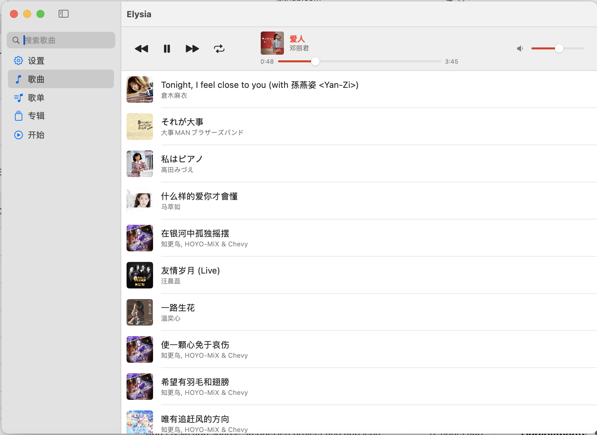
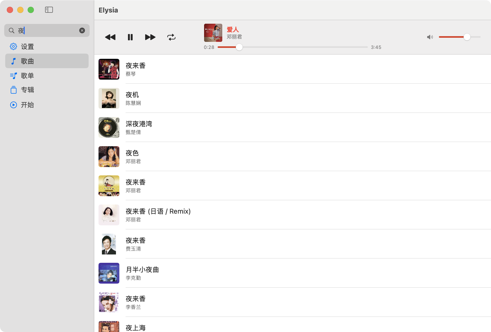
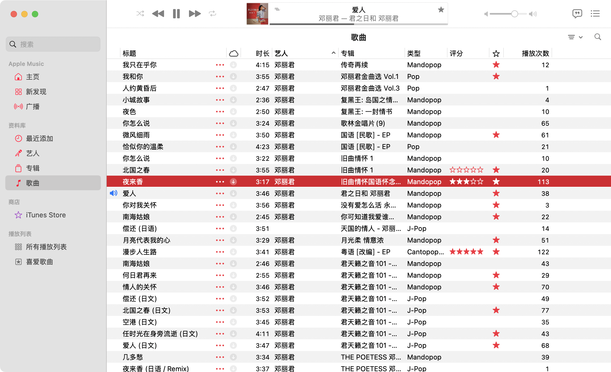
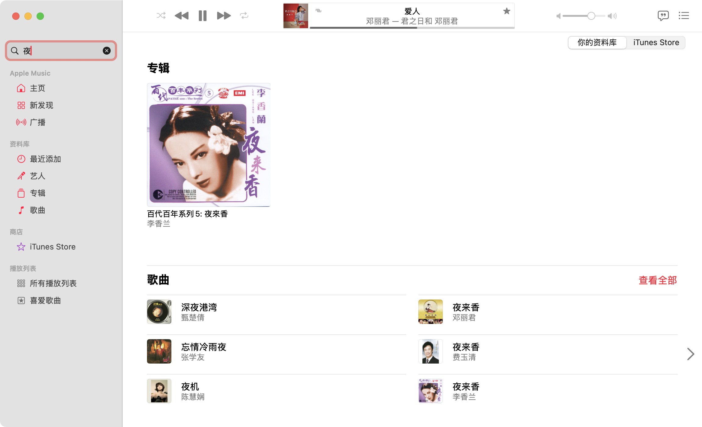
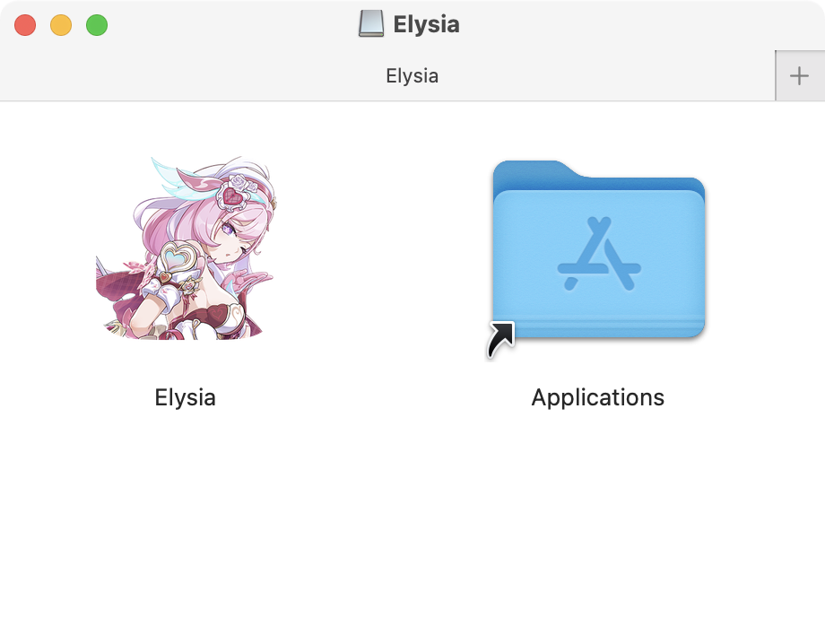

<div align="center">
             
             <h1>Elysia</h1>
</div>  


# Elysia

Apple Music 缺失的图形界面

[English](./README.md) · **简体中文**

## 官方网站  
[elysia.macwave.org](https://elysia.macwave.org)  （短链接：[e.macwave.org](https://e.macwave.org)）  
## 下载  

[点此下载](https://elysia.macwave.org/Downloads)  

## 系统要求

- macOS Ventura13 或更高版本
- Apple Music，且已建立资料库（Elysia 只是驱动「音乐」App，本身不播放音频）

## 界面语言

界面提供英文与简体中文两套独立语言包，分别位于 `Elysia/en.lproj` 与
`Elysia/zh-Hans.lproj`。默认跟随系统语言；可在**设置 → 语言**中手动指定，
重启后生效。

## 为什么选择Elysia？

**1.迎来清爽页面。** I.用专辑封面覆盖歌曲卡片左侧、增加识别效率。II.去掉了“广播”“iTunes”等不常用的侧边栏目和“类型”“评分”“播放次数”等状态栏。  
**2.优化界面结构。** I.将“艺人”栏目移至歌曲下方同时变为灰色和更小字体，便于阅读的同时兼顾美观。II.正在播放的歌曲的专辑封面边框变为红色、字体变为加粗的红色字体，同时进度条和音量调节条也为红色，增加辨识度。  
**3.AppleMusic没有的功能。** 拖动歌曲可以调节顺序，并可以一键恢复默认。  
   
## 对比图片

**Elysia：**

<p align="center">
  
</p>

<p align="center">
  
</p>

**Apple Music：**

<p align="center">
  
</p>

<p align="center">
  
</p>

## 安装

1. 从[Downloads（elysia.macwave.org/Downloads）](https://elysia.com/downloads)或 [Releases 页面](../../releases) 下载 `Elysia-x.y.z.dmg`。
2. 打开 DMG，把 **Elysia** 拖到 **Applications** 快捷方式上。
3. 从「应用程序」启动 Elysia，macOS 询问时允许它控制 **「音乐」**。

<p align="center">
  
</p>

### 如果 macOS 拒绝打开

发布的版本已签名但**未公证**（公证需要付费的 Apple 开发者账号），因此
Gatekeeper 会提示「无法验证开发者」。以下任一方法都可以：

- 在「应用程序」中右键（或按住 Control 点击）Elysia，选择**打开**，再确认一次。
  macOS 会记住这个选择。
- 或者清除下载隔离标记：

  ```sh
  xattr -dr com.apple.quarantine /Applications/Elysia.app
  ```

## 使用方法

**播放/暂停**： 双击歌曲或点击播放/暂停键  
**上一首/下一首**： 点击顶部按钮，或使用键盘 F7 / F9  
**调整歌曲顺序**： 拖动歌曲到要调整到的两首歌之间并松开  
**切换播放模式**： 点击顶部播放模式按钮（无/列表循环/单曲循环）  
**调整语言/恢复默认歌曲排序**： 点击左侧边栏的**设置**按钮并在窗口内调整。  
**离线**： 未下载的歌曲会显示为灰色、点了也播不了；点它会说明原因。  
**歌单**： 只保存在 Elysia 内，不会写入 Apple Music，也不改动 Apple Music 的任何内容。  
**新建歌单 ⌘N**： 输入名称、勾选要加入的歌曲，再按**确认 ⌘Enter**。  
**进入歌单**： 双击歌单，或点它右侧的箭头；进入后与**歌曲**界面一致，播放、进度、媒体键都一样。  
**编辑歌曲 ⌘E**： 进入歌单后按 ⌘E，或在列表里右键歌单；已在歌单里的歌曲会预先勾好。  
**重命名 ⌘⇧R**： 选中歌单后按 ⌘⇧R，或在列表里右键歌单。  
**删除歌单 ⌘D**： 选中歌单后按 ⌘D；没有选中时会先列出歌单让你选。每次删除都会再确认一次。  
**拖动排序**： 歌单之间可以拖动调整先后，歌单内的歌曲也可以；拖到列表上下边缘会自动滚动；歌单封面始终取第一首的封面。  
**一次选中多首**： 在新建/编辑歌单的窗口里按住一首歌上下拖动，途经的歌曲会一并选中。  
**专辑**： 侧边栏的「专辑」按 Apple Music 资料库里的专辑归并，按专辑名排列（中文按拼音），每张显示封面、歌手与歌曲数。  
**进入专辑**： 双击专辑，或点它右侧的箭头；里面的歌曲按碟号、曲目号排好，「上一首 / 下一首」也按这张专辑的顺序走。专辑信息只读取，不会改动 Apple Music。  
**改名 / 屏蔽专辑 ⌘R / ⌘I**： 右键专辑可以重命名或屏蔽；选中专辑后按 ⌘R 改名、⌘I 屏蔽。改名与屏蔽只记在 Elysia 里，Apple Music 里的专辑名不变；屏蔽后专辑从列表收起，歌曲仍在「歌曲」页。  
**批量处理 ⌘B**： 右上角「选择」进入选择模式，勾选多张后可一起改名（逐张列出的输入框）或屏蔽；「屏蔽的专辑」入口里可以单个恢复、批量恢复或全部恢复。  
**转为歌单 ⌘⇧N**： 右键专辑即可把它变成同名歌单（曲目与顺序和专辑一致）；按 ⌘B 勾选多张后可一次转换，一张专辑生成一个歌单，重名会自动接上序号。  
**歌手**： 侧边栏的「歌手」按资料库里的歌手归并，按歌手名排列（中文按拼音），每行显示封面、专辑张数与歌曲数。  
**进入歌手**： 双击歌手或点右侧箭头，里面是这位歌手的全部曲目；「上一首 / 下一首」也按这个顺序走。  
**屏蔽歌手 ⌘I**： 右键歌手或选中后按 ⌘I，把他从列表收起（歌曲仍在「歌曲」页）；右上角红色的「屏蔽的歌手」里可以右键或按 ⌘I 解除屏蔽，也能「选择 ⌘B」后批量解除、或全部解除。  
**关于**： 侧边栏最下方的「关于」里有官网、GitHub、许可证和日志入口。  
**首次安装/更新**： 如果无法识别歌单，请在**设置→曲库**中刷新歌单。若仍然失败，请尝试退出 Apple Music 后重新执行上述操作。  
## 从源码构建

Xcode 工程由 [XcodeGen](https://github.com/yonaskolb/XcodeGen) 依据 `project.yml`
生成，因此 `Elysia.xcodeproj` 是可以随时丢弃的产物：

```sh
xcodegen generate
open Elysia.xcodeproj
```

要在 `dmg/` 下生成已签名、兼容 Intel 的通用版（arm64 + x86_64）DMG：

```sh
Scripts/package-dmg.sh
```

脚本会自动使用钥匙串中第一个 `Apple Development` 证书；可通过 `SIGN_IDENTITY`
指定其它证书，或设为 `-` 使用 ad-hoc 签名。脚本**刻意不启用硬化运行时**：启用后
需要额外声明 `com.apple.security.automation.apple-events` 权限才能继续控制「音乐」，
而个人团队本就无法公证，启用它没有收益。

### 查看打包好的镜像

`Scripts/elysiadmgrun` 会挂载镜像并在 Finder 中打开，是检查安装体验最快的方式：

```sh
Scripts/elysiadmgrun              # dmg/ 下最新的镜像
Scripts/elysiadmgrun path.dmg     # 指定镜像
Scripts/elysiadmgrun --eject      # 卸载
```

想把它变成一条命令，做个软链放到 `PATH` 里即可：

```sh
ln -s "$PWD/Scripts/elysiadmgrun" ~/.local/bin/elysiadmgrun
```

App 图标由单张原图通过 `Scripts/generate-appicon.py` 重新生成。
